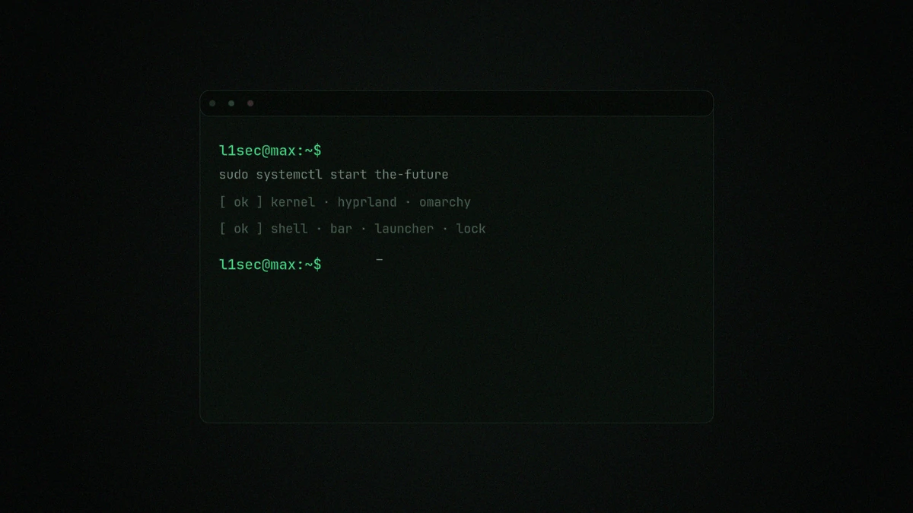
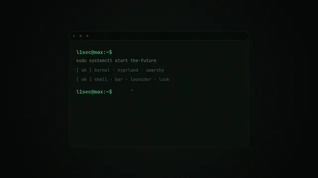
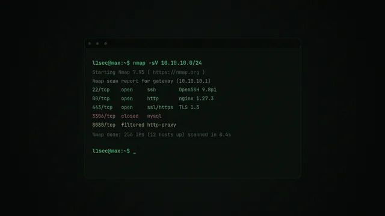
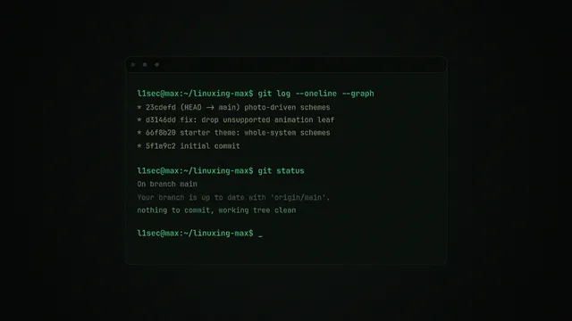
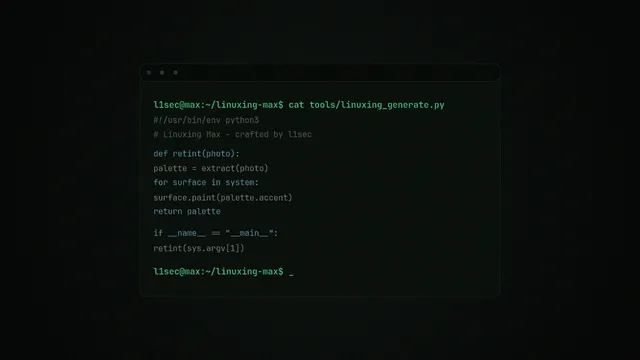
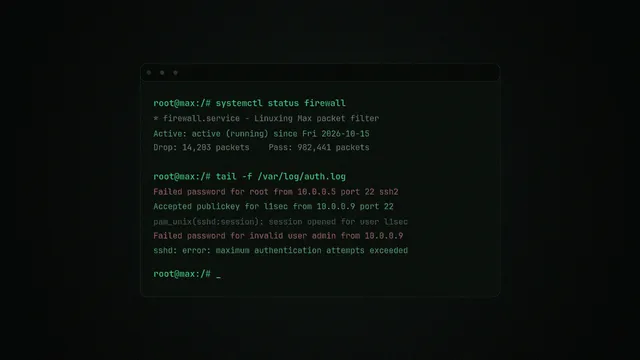
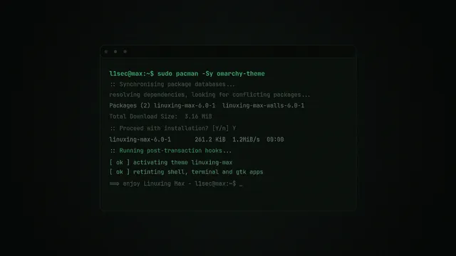

# Linuxing Max

A **Linux / software / cyber-security** theme for [Omarchy](https://omarchy.org/).
One coherent **green** palette for the whole system — terminal, editor, browser,
bar / menu / launcher / lock / OSD, Hyprland window borders and native GTK apps
— with a set of hacker / developer / Linux / Omarchy **terminal-scene
wallpapers** all in the same green look. Soft squircle corners, glassmorphism
blur, reduced window opacity and a rich animation set round out the "Linuxing
glides through the terminal" feel.

> Installs through Omarchy's own `omarchy theme install` (a `colors.toml`-driven,
> code-free theme); a one-time bootstrap then puts the wallpaper switcher and the
> soft look in place.



---

## Quick start

```bash
# one-command install (clones + bootstraps)
bash <(curl -fsSL https://raw.githubusercontent.com/l1secc/linuxing-max/main/tools/bootstrap.sh)

# …or, step by step:
omarchy theme install https://github.com/l1secc/linuxing-max
~/.config/omarchy/themes/linuxing-max/tools/install.sh

# switch the wallpaper (the palette stays green)
linuxing-scheme            # next wallpaper
linuxing-scheme recon      # jump to one by name
linuxing-scheme prev       # previous
linuxing-scheme list       # show them
```

---

## The wallpapers

Every wallpaper is a terminal scene in the same green palette:

| Name | Scene |
|------|-------|
| **terminal** (default) | `linuxing@max:~$ systemctl start …` |
| **recon** | an `nmap -sV` port scan |
| **developer** | a `git log --graph` session |
| **editor** | a Python source file |
| **root** | a root shell watching the firewall / auth log |
| **omarchy** | `pacman -Sy omarchy-theme` install |

| terminal | recon | developer |
|---|---|---|
|  |  |  |

| editor | root | omarchy |
|---|---|---|
|  |  |  |

---

## How it works

### What `omarchy theme install` does

Omarchy clones this repo into `~/.config/omarchy/themes/linuxing-max`, keeps
every colour/config file, and **drops the files that would run code** —
`*.lua`, terminal configs and `vscode.json` are regenerated from `colors.toml`
by Omarchy itself. That is deliberate: a theme pulled from a repo can never run
code on your machine by itself.

### What the bootstrap adds (the one-time step you run yourself)

`tools/install.sh` → `tools/linuxing-bootstrap` installs, idempotently:

- **`~/.config/hypr/looknfeel.lua`** — rounded squircle corners (`rounding 16`),
  glassmorphism blur, soft shadows, reduced window opacity (`0.92 / 0.85`) and
  the full animation set. This is the only thing a cloned theme cannot ship.
- **foot terminal translucency** — `alpha=0.82`, text stays crisp.
- **eza file-kind colours** — folders phosphor green, text stays white.
- **native GTK overrides** — symlinked at `~/.config/gtk-{3,4}.0/gtk.css` so
  they follow `omarchy theme set`.
- **`linuxing-scheme` on your PATH** (the wallpaper switcher), plus a `theme-set`
  hook so `omarchy theme update` / re-applying the theme keeps everything current.

Uninstall with `~/.config/omarchy/themes/linuxing-max/tools/install.sh --uninstall`.

### The renderer

`tools/linuxing_generate.py` renders the single green palette from
`tools/template/*` into the repo root (swapping `@token@` placeholders): the
terminal canvas is true black, the ink is a green-tinted near-white, and the
accent / desktop-chrome surfaces / selection / cursor / 3-stop window border all
follow the green. Re-run it after editing the templates:

```bash
python3 tools/linuxing_generate.py
```

---

## Layout

```
linuxing-max/
├── colors.toml            # the green palette — drives everything
├── shell.toml             # bar / menu / launcher / lock / OSD glass surfaces
├── waybar.css             # waybar parity (frosted-glass cards)
├── hyprland.conf          # legacy/non-Omarchy Hyprland parity
├── gtk.css + gtk-3.0/ + gtk-4.0/   # native GTK tokens
├── icons.theme            # Yaru-prussiangreen (change to taste)
├── chromium.theme         # browser chrome tint
├── eza/theme.yml          # file-kind colours
├── foot/linuxing-foot.ini # translucent terminal block
├── hypr/looknfeel.lua     # animations + rounding + blur + opacity
├── backgrounds/           # the green terminal wallpapers
├── tools/
│   ├── linuxing_generate.py      # green palette renderer
│   ├── linuxing-scheme           # wallpaper switcher (on PATH)
│   ├── linuxing-bootstrap        # soft look installer
│   ├── generate-wallpapers.sh    # wallpaper generator
│   ├── install.sh                # bootstrap + hook
│   └── bootstrap.sh              # curl one-liner
├── preview.webp / .jpg    # theme-picker thumbnail
├── screenshot.webp        # real desktop shot (README hero)
├── docs/                  # wallpaper thumbnails embedded in this README
└── distribution/          # for the omarchy-site community listing
```

---

## Tuning

**Softer / more rounded** — edit `hypr/looknfeel.lua` and re-run
`tools/linuxing-bootstrap`:

- `decoration.rounding` — `10` subtle, `16` this, `22` bubbly.
- `o.window(... { opacity = "0.92 0.85" })` — `"0.96 0.92"` barely there,
  `"0.88 0.80"` bold.
- `foot/linuxing-foot.ini` `alpha` — `0.82` default, `0.78` more transparent.

**More/less translucent surfaces** — the `*-alpha` keys in
`tools/template/shell.toml`, then `python3 tools/linuxing_generate.py`.

**Different icons** — edit `icons.theme` (any installed icon theme).

---

## Wallpapers

Original, procedurally generated 1920×1080 green terminal scenes (terminal,
recon, developer, editor, root, omarchy). Regenerate with
`tools/generate-wallpapers.sh` (needs ImageMagick 7 and the JetBrainsMono Nerd
Font). Drop your own into `~/.config/omarchy/backgrounds/linuxing-max/`.

---

## License

MIT — see [LICENSE](LICENSE). The wallpapers are original procedural artwork
generated for this theme.
